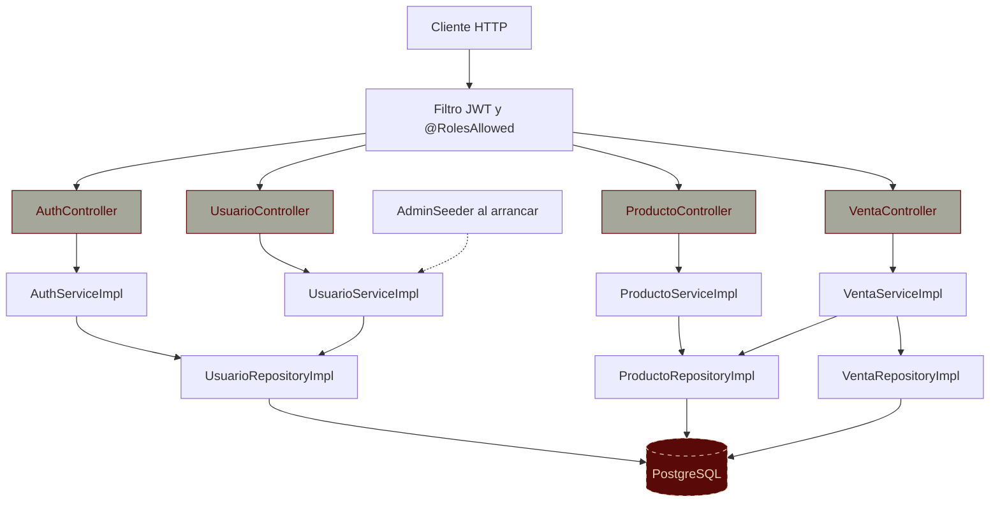

<div align="center" style="padding: 4% 0;">

# API Web: Facturación

<p>
  
  
  
  
</p>

<p>
  
  
  
</p>

</div>

---

## Descripción

API REST para gestionar un catálogo de **productos** y registrar **ventas** con control de stock, cálculo de IVA y acceso por roles. Está construida con **Quarkus** siguiendo una arquitectura en capas (controlador, servicio, repositorio) y autenticación con **JWT** firmados con RSA.

- **Productos:** alta de productos y suma de stock sobre productos existentes.
- **Ventas:** registro de ventas con varios productos. El precio lo fija el servidor, se descuenta el stock y el total incluye IVA (15 %). Todo ocurre en una sola transacción.
- **Usuarios y roles:** login con JWT. Los roles `ADMIN` y `VENDEDOR` controlan qué puede hacer cada usuario.
- **Documentación:** especificación OpenAPI y Swagger UI generadas automáticamente.

## Características

| Característica | Descripción |
|---|---|
| **Ventas transaccionales** | Descuenta stock y guarda la venta en una sola transacción; si algo falla, no queda nada a medias. |
| **Reglas de negocio** | Rechaza stock insuficiente (409), productos inexistentes (404) y productos repetidos en una venta (400). |
| **Autenticación JWT** | Login en `/auth/login`; el token se firma con una clave RSA privada y expira en 1 hora. |
| **Control de acceso por rol** | `@RolesAllowed` en cada controlador. Sin token responde 401; sin permiso, 403. |
| **Contraseñas seguras** | Se guardan como hash BCrypt, nunca en texto plano. |
| **Validación de entrada** | Bean Validation con errores HTTP consistentes (`{"mensaje": "..."}`). |
| **Documentación OpenAPI** | Endpoints, roles y códigos de respuesta documentados en Swagger UI. |
| **Pruebas** | Unitarias con Mockito e integración con PostgreSQL real en Testcontainers. |

## Arquitectura

La API expone controladores JAX-RS que llaman a servicios por su interfaz, y los servicios usan repositorios JPA. Los datos de entrada y salida viajan en DTOs (`*To`); las entidades nunca se exponen.



**Nodos centrales:**

| Archivo | Rol |
|---|---|
| `controller/VentaController.java` | Endpoints de ventas (`/ventas`). |
| `service/VentaServiceImpl.java` | Reglas de negocio: stock, precios, IVA y transacción. |
| `service/AuthServiceImpl.java` | Valida credenciales y firma el JWT. |
| `service/AdminSeeder.java` | Crea el usuario `admin` al arrancar si no hay usuarios. |
| `controller/NegocioExceptionMapper.java` | Convierte los errores de negocio en respuestas HTTP. |
| `repository/modelo/` | Entidades JPA: `Producto`, `Venta`, `DetalleVenta`, `Usuario`. |

## Estructura del proyecto

```text
app-web-api/
├── 📁 certs/                          # Claves RSA para firmar JWT (no versionar la privada)
├── 📁 src/
│   ├── 📁 main/
│   │   ├── 📁 java/com/programacion/api/
│   │   │   ├── 📁 controller/         # Endpoints JAX-RS (productos, ventas, usuarios, auth)
│   │   │   ├── 📁 service/            # Interfaces, implementaciones y reglas de negocio
│   │   │   │   └── 📁 to/             # DTOs de entrada y salida
│   │   │   └── 📁 repository/         # Repositorios JPA
│   │   │       └── 📁 modelo/         # Entidades JPA
│   │   ├── 📁 docker/                 # Dockerfiles (jvm, native, legacy-jar)
│   │   └── 📁 resources/
│   │       ├── 📁 db/migration/       # Migraciones Flyway (V1__esquema_inicial.sql, ...)
│   │       └── 📄 application.properties
│   └── 📁 test/java/com/programacion/api/
│       ├── 📄 service/VentaServiceImplTest.java      # Unitarias (Mockito)
│       ├── 📄 service/ProductoServiceImplTest.java   # Unitarias (Mockito)
│       ├── 📄 VentaResourceIT.java                   # Integración (Testcontainers)
│       └── 📄 PostgresTestResource.java              # PostgreSQL efímero para las pruebas
├── 📄 pom.xml
└── 📄 mvnw
```

## Stack tecnológico

| Categoría | Tecnología |
|---|---|
| Framework | Quarkus 3.17 (JAX-RS con RESTEasy, CDI con ArC) |
| Persistencia | Hibernate ORM (JPA) y PostgreSQL |
| Seguridad | SmallRye JWT (firma RSA) y BCrypt (Elytron) |
| Migraciones | Flyway (`db/migration`) |
| Operación | SmallRye Health, Micrometer con Prometheus y logs en JSON |
| Validación | Hibernate Validator (Bean Validation) |
| Documentación | SmallRye OpenAPI y Swagger UI |
| Pruebas | JUnit 5, Mockito, REST Assured y Testcontainers |
| Construcción | Maven (wrapper incluido) |

## Requisitos

- JDK 17 o superior (probado con JDK 21). Quarkus 3.17.
- PostgreSQL en ejecución con una base de datos llamada `pweb` (o ajusta `quarkus.datasource.jdbc.url`).
- Docker, solo para ejecutar las pruebas de integración.
- OpenSSL, para generar las claves JWT (o cualquier herramienta que genere un par RSA en PEM).

## Configuración

### 1. Claves JWT

```shell script
mkdir certs
openssl genpkey -algorithm RSA -pkeyopt rsa_keygen_bits:2048 -out certs/privateKey.pem
openssl pkey -in certs/privateKey.pem -pubout -out certs/publicKey.pem
```

La carpeta `certs/` no debe subirse al repositorio.

### 2. Variables de entorno

| Variable | Obligatoria | Descripción |
|---|---|---|
| `DB_PASSWORD` | Sí | Contraseña del usuario `postgres`. |
| `ADMIN_PASSWORD` | Sí | Contraseña inicial del usuario `admin`. Solo se usa si la tabla de usuarios está vacía. |
| `JWT_PRIVATE_KEY_LOCATION` | No | Ruta a la clave privada. Por defecto `certs/privateKey.pem`. |
| `JWT_PUBLIC_KEY_LOCATION` | No | Ruta a la clave pública. Por defecto `certs/publicKey.pem`. |
| `JWT_ISSUER` | No | Emisor de los tokens. Por defecto `api-web`. |

En Windows (PowerShell) puedes definirlas así: `$env:DB_PASSWORD = "..."`.

## Uso

La API usa el puerto **8081** y la ruta base **`/facturacion/v1.1`**.

1. **Arranca la aplicación:**

   ```shell script
   ./mvnw quarkus:dev
   ```

2. **Inicia sesión** con el usuario `admin` y recibe un token:

   ```shell script
   curl -X POST http://localhost:8081/facturacion/v1.1/auth/login \
     -H "Content-Type: application/json" \
     -d '{"username":"admin","password":"<ADMIN_PASSWORD>"}'
   ```

3. **Usa el token** en las peticiones protegidas con la cabecera `Authorization: Bearer <token>`.

4. **Ejemplo de venta:**

   ```shell script
   curl -X POST http://localhost:8081/facturacion/v1.1/ventas \
     -H "Content-Type: application/json" \
     -H "Authorization: Bearer <token>" \
     -d '{"cedulaCliente":"0102030405","detalles":[{"productoId":1,"cantidad":2}]}'
   ```

### Endpoints

| Método | Ruta | Acceso | Descripción |
|---|---|---|---|
| `POST` | `/auth/login` | Público | Devuelve un JWT. |
| `POST` | `/usuarios` | `ADMIN` | Crea un usuario con rol `ADMIN` o `VENDEDOR`. |
| `GET` | `/productos` | `ADMIN`, `VENDEDOR` | Lista los productos. |
| `GET` | `/productos/{id}` | `ADMIN`, `VENDEDOR` | Obtiene un producto. |
| `POST` | `/productos` | `ADMIN` | Crea un producto (sin `id`) o suma stock (con `id`). |
| `POST` | `/ventas` | `ADMIN`, `VENDEDOR` | Registra una venta. Responde 201. |
| `GET` | `/ventas` | `ADMIN`, `VENDEDOR` | Lista las ventas. |
| `GET` | `/ventas/{id}` | `ADMIN`, `VENDEDOR` | Obtiene una venta. |

La documentación interactiva está en `http://localhost:8081/facturacion/v1.1/q/swagger-ui` (ruta por defecto de Quarkus).

### Operación

| Ruta | Descripción |
|---|---|
| `/q/health` | Estado de la aplicación y de la conexión a la base de datos. Responde 200 con `"status": "UP"`. |
| `/q/metrics` | Métricas en formato Prometheus (JVM, HTTP y pool de conexiones). |

### Base de datos y migraciones

El esquema lo gestiona **Flyway**. Las migraciones están en `src/main/resources/db/migration/` y se aplican al arrancar la aplicación.

- `V1__esquema_inicial.sql` crea las tablas `producto`, `venta`, `detalle_venta` y `usuario`, junto con sus secuencias.
- Hibernate está en modo `validate`: si el esquema no coincide con las entidades, la aplicación no arranca.
- Una base que ya tiene tablas (creadas antes con Hibernate) se marca automáticamente como versión 1 y no se modifica.

Para cambiar el esquema, añade un nuevo archivo `V2__descripcion.sql` con el siguiente número de versión. No edites migraciones que ya se hayan aplicado.

### Logs

- En **desarrollo** (`quarkus:dev`) los logs son legibles y se muestran las consultas SQL.
- En **producción** (`java -jar`) los logs salen en JSON, listos para un agregador como ELK o Loki. Las consultas SQL no se registran.

### Códigos de error

| Código | Cuándo |
|---|---|
| 400 | Datos de entrada inválidos, cédula que no tiene 10 dígitos o producto repetido en la venta. |
| 401 | Falta el token o las credenciales son incorrectas. |
| 403 | El rol no tiene permiso para la operación. |
| 404 | Producto o venta inexistente. |
| 409 | Stock insuficiente o usuario ya existente. |

## Comandos

| Comando | Descripción |
|---|---|
| `./mvnw quarkus:dev` | Servidor de desarrollo con recarga en caliente. |
| `./mvnw package` | Genera `target/quarkus-app/quarkus-run.jar`. |
| `./mvnw package -Dquarkus.package.jar.type=uber-jar` | Genera un JAR ejecutable con todas las dependencias. |
| `./mvnw package -Dnative` | Genera un ejecutable nativo (requiere GraalVM o `-Dquarkus.native.container-build=true`). |
| `./mvnw test` | Ejecuta las pruebas unitarias. |
| `./mvnw verify -DskipITs=false` | Ejecuta también las pruebas de integración (requiere Docker). |

## Pruebas

```shell script
./mvnw test
```

Las pruebas unitarias cubren las reglas de `VentaServiceImpl` (cálculo de IVA, descuento de stock, stock insuficiente, productos repetidos y productos inexistentes) y de `ProductoServiceImpl` (alta y suma de stock).

```shell script
./mvnw verify -DskipITs=false
```

La prueba de integración `VentaResourceIT` levanta PostgreSQL con Testcontainers y verifica el flujo HTTP completo, incluidos los 401 y 403.

## Información general

- **Artefacto:** `com.programacion.web.api:api-web:1.0.0-SNAPSHOT`
- **Paquete base:** `com.programacion.api`
- **Idioma de la interfaz y del código de dominio:** Español
- **Estado:** en desarrollo.
- **Notas:**
  - El IVA es del 15 % y está definido en `VentaServiceImpl.TASA_IVA`.
  - La cédula del cliente debe tener 10 dígitos.
  - Los archivos de `GreetingResource` y `GreetingResourceTest` son código de plantilla de Quarkus.
